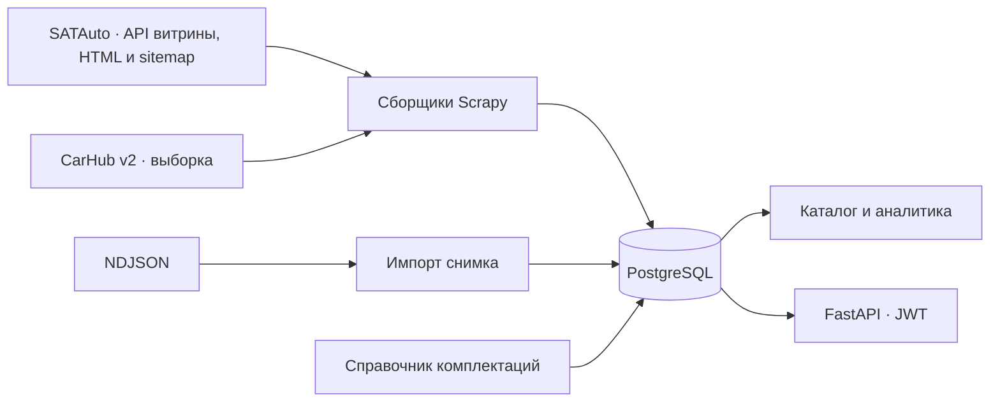

# Архитектура

Номер прогона связывает объявления с источником и метриками загрузки. PostgreSQL хранит исходный JSON, курсоры и время наблюдения. Подготовленная проекция `vehicle_inventory` обновляется триггером в транзакции записи. Веб-интерфейс и API читают сохранённые данные. Ссылка на японский лот может запрашивать текущий адрес на SATAuto при открытии.

Docker Compose собирает общий образ для веб-каталога, API и сборщика. При старте веб-каталог дожидается базы, подготавливает схему и только потом отвечает на HTTP. API и фоновый сборщик запускаются по запросу. Именованный том `catalog-db` сохраняется при остановке контейнеров. `./parse demo` использует отдельный проект Compose со своим томом и портами.

| Маршрут веб-каталога | Назначение |
| --- | --- |
| `/` | Список объявлений, поиск, фильтры и пагинация |
| `/car?run=1&id=100000000000000001` | Карточка объявления из чистой синтетической базы |
| `/analytics` | Счётчики HTTP, предложения и полнота карточек по странам |
| `/healthz` | Проверка HTTP после подготовки схемы |

| Переменная | Назначение |
| --- | --- |
| `CATALOG_WEB_PORT` | Порт веб-каталога на хосте, по умолчанию 8765 |
| `CATALOG_API_PORT` | Порт API на хосте, по умолчанию 8766 |
| `CATALOG_DB_PORT` | Порт PostgreSQL на хосте, по умолчанию 55432 |
| `DATABASE_URL` | DSN для CLI вне Docker, по умолчанию основная Compose-база |
| `TEST_DATABASE_URL` | DSN для тестов, требуется право `CREATE DATABASE` |
| `CATALOG_JWT_SECRET` | Секрет подписи в локальном файле `.api.env` |
| `CATALOG_API_ORIGIN` | Адрес согласованного источника с совместимым API |
| `CATALOG_API_TOKEN` | Опциональный Bearer-токен для совместимого источника |

При смене рабочего порта PostgreSQL укажите соответствующий порт в `DATABASE_URL` или `TEST_DATABASE_URL` для команд, которые выполняются на хосте. Для тестовой базы можно выполнить `TEST_DATABASE_URL=... .venv/bin/python tests/run.py`.

Партнёрский контур CarHub может использовать отдельные способы авторизации и пагинации. Перед подключением сверяйте его контракт с действующим клиентом. [Документация CarHub](https://carhubauto.ru/api/)
