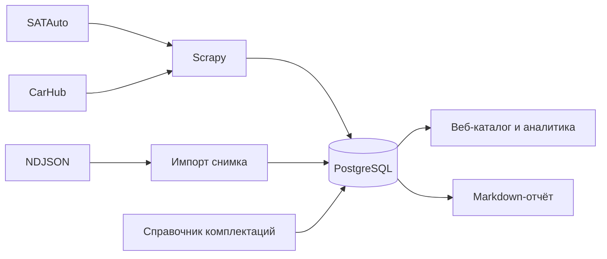

# Архитектура

Сборщик и веб-каталог используют одну базу. Веб-сервер читает сохранённые данные. HTTP-запросы к поставщикам выполняются из команд сбора. Номер прогона связывает объявления с источником и метриками загрузки.

`compose.yaml` поднимает PostgreSQL 17 и локальный веб-сервер. Том `catalog-db` сохраняет данные при остановке контейнеров. Веб-интерфейс слушает `127.0.0.1:8765`, PostgreSQL доступен на `127.0.0.1:55432`. Схема подготавливается командой `make up` или автоматически перед командами с доступом к базе.

| Маршрут | Назначение |
| --- | --- |
| `/` | Объявления с поиском по ID, фильтрами, сортировкой и пагинацией |
| `/?scope=all` | Индекс SATAuto со сведениями для совпавших карточек |
| `/car?run=4&id=2598122` | Подробности конкретной карточки и ссылки на источники |
| `/analytics` | Охват и история прогонов |
| `/analytics?run=4` | Показатели отдельного прогона |

Номера в примерах относятся к демонстрационной базе. На чистой установке номера назначаются заново. Команды сбора печатают число записей, HTTP-запросы, статусы, время и ошибки. Сохранённые показатели демонстрации доступны в [отчёте](../reports/RESULTS.md).

| Переменная окружения | Назначение |
| --- | --- |
| `DATABASE_URL` | DSN для локального CLI. По умолчанию используется Compose-база на порту 55432 |
| `CATALOG_API_ORIGIN` | Адрес согласованного источника с совместимым API |
| `CATALOG_API_TOKEN` | Опциональный Bearer-токен для совместимого источника |
| `TEST_DATABASE_URL` | DSN для интеграционных тестов |

Партнёрский контур CarHub может иметь отдельные способы авторизации и пагинации. Перед подключением сверяют его контракт с текущим курсорным клиентом. [Документация CarHub](https://carhubauto.ru/api/)
